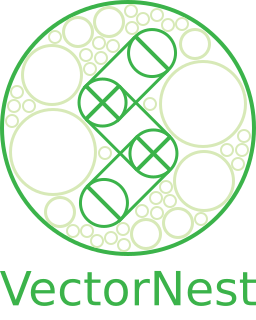
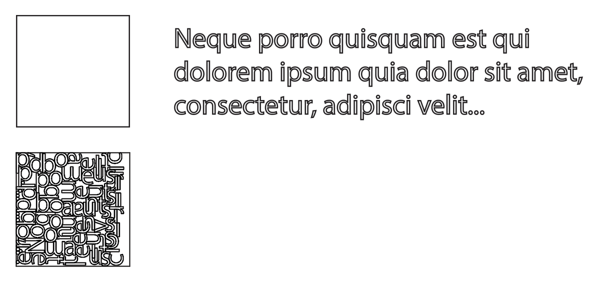
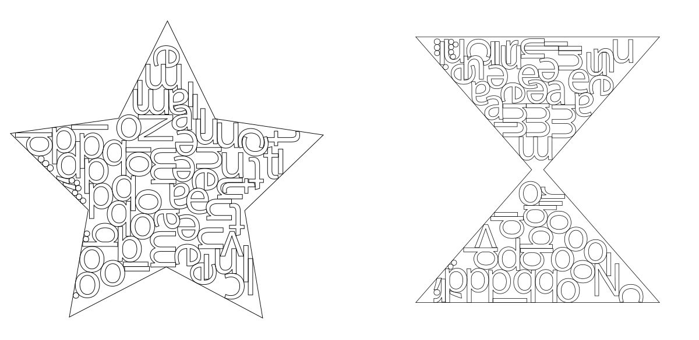
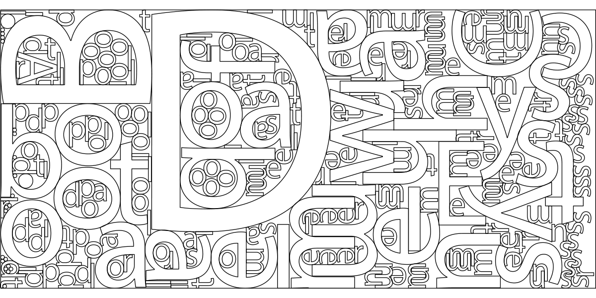
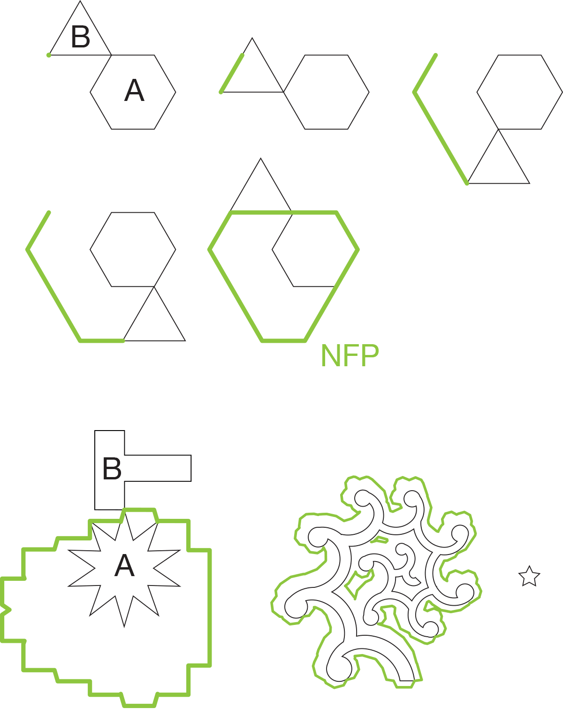
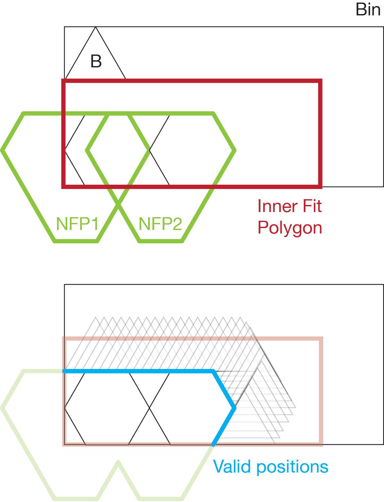
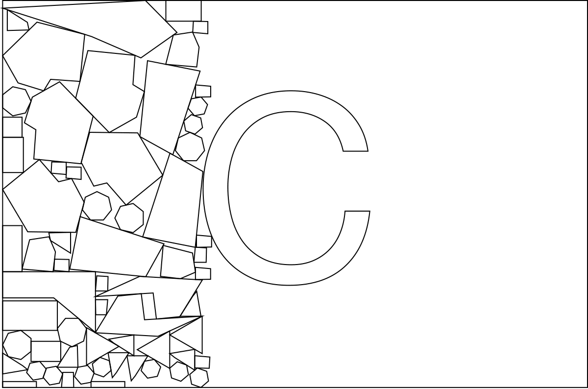
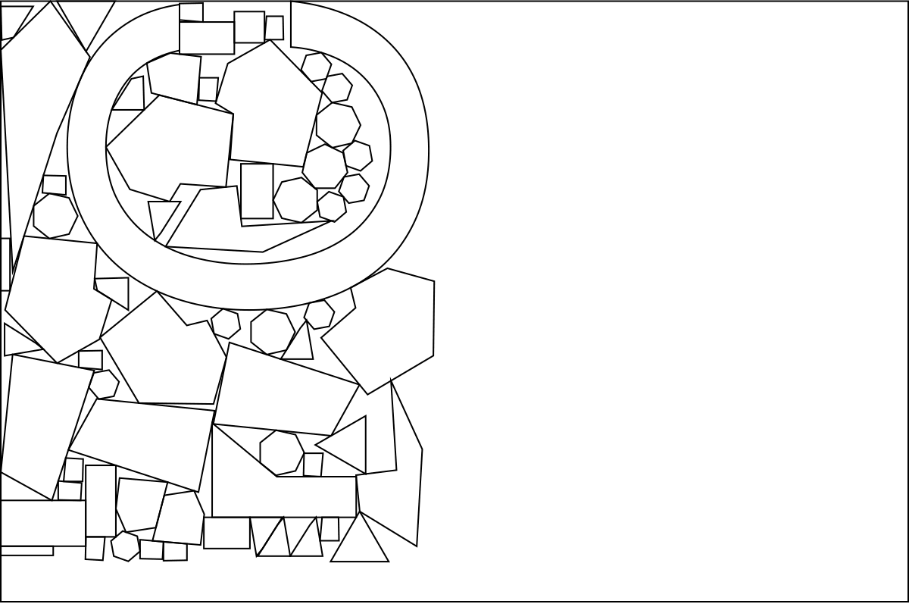
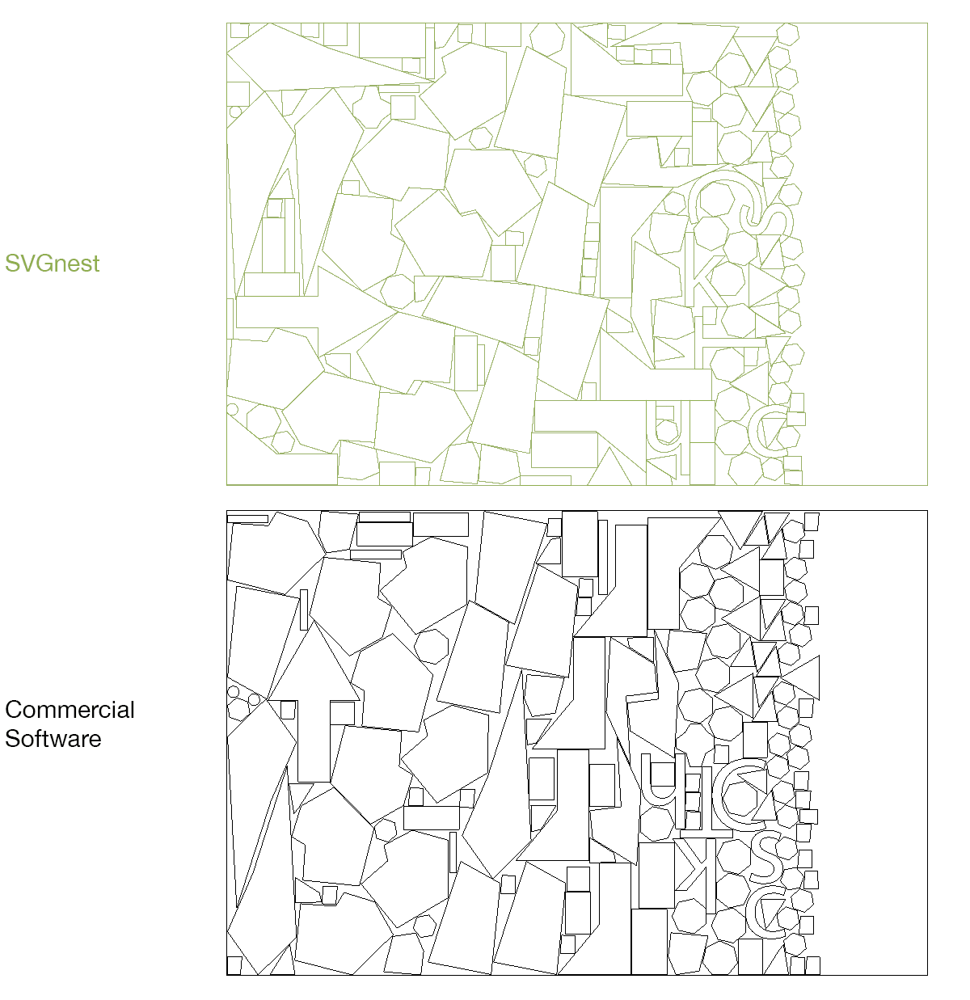
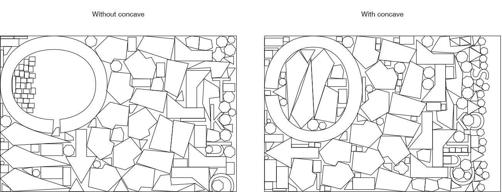

<p align="center">
  
</p>

**VectorNest**: A vector nesting tool that runs in the browser or from Node.js.

This fork is a TypeScript monorepo with Rust/WebAssembly cores for vector-format conversion and polygon packing. Parsing and conversion run in Rust without DOM parsing; the browser DOM is used only to display the normalized vector preview and keep the GUI selection behavior. The web app and Node CLI support SVG, PDF-compatible Adobe Illustrator (`.ai`), and ASCII DXF (`.dxf`) files.

**Demo:** https://yuriilychak.github.io/SVGnest/

(requires SVG and webworker support). Mobile warning: running the demo is CPU intensive.

## Contents

- [What is nesting?](#what-is-nesting)
- [Usage](#usage)
- [Development](#development)
  - [Packages](#packages)
  - [Architecture notes](#architecture-notes)
- [Outline of algorithm](#outline-of-algorithm)
  - [Placing the part](#placing-the-part)
  - [Optimization](#optimization)
- [Evaluating fitness](#evaluating-fitness)
- [Performance](#performance)
- [Configuration parameters](#configuration-parameters)
- [To-do](#to-do)

references (PDF):

-   [López-Camacho _et al._ 2013](http://www.cs.stir.ac.uk/~goc/papers/EffectiveHueristic2DAOR2013.pdf)
-   [Kendall 2000](http://www.graham-kendall.com/papers/k2001.pdf)
-   [E.K. Burke _et al._ 2006](http://citeseerx.ist.psu.edu/viewdoc/download?doi=10.1.1.440.379&rep=rep1&type=pdf)

## What is "nesting"?

Given a square piece of material and some letters to be laser-cut:



We want to pack all the letters into the square, using as little material as possible. If a single square is not enough, we also
want to minimize the number of squares used.

In the CNC world this is called "[nesting](http://sigmanest.com/)", and [software](http://www.mynesting.com/) that
[does this](http://www.autodesk.com/products/trunest/overview) is typically targeted at
[industrial customers](http://www.hypertherm.com/en/Products/Automated_cutting/Nesting_software/) and
[very expensive](http://www.nestfab.com/pricing/).

VectorNest is a free and open-source alternative that solves this problem with the orbital approach outlined in [E.K. Burke *et
al.* 2006], using a genetic algorithm for global optimization. It works for arbitrary containers and concave edge cases, and
performs on-par with existing commercial software.



It also features part-in-part support, for placing parts in the holes of other parts.



## Usage

Make sure all parts have been converted to outlines, and that no outlines overlap. Upload a supported vector file and select one of the
outlines to be used as the bin.

All other outlines are automatically processed as parts for nesting.

## Development

Requirements: Node.js 20.19+ (npm 8+) and Rust with `wasm-pack` on `PATH`.

```sh
npm install
npm run dev
```

The web application builds its WASM assets automatically before starting or producing a production build:

```sh
npm run build
```

The browser application lives in `apps/web`. Its build prepares the SVG, AI, and DXF format WASM modules plus the packing worker/WASM assets, then Vite builds the UI. Format modules load only when their file type is selected.

The terminal application lives in `apps/node`. It imports SVG, PDF-compatible AI, or ASCII DXF, runs the same Rust/WASM packing core, and writes the source format back out. It uses persistent Node worker threads by default, or `--single-thread` for the shared single-thread executor:

```sh
npm --workspace @svgnest/node start -- input.svg --bin 0 --out nested.svg --iterations 100
```

### Packages

- `packages/plugins/format` (`@svgnest/format-plugin`) defines the shared adapter contract: `inputToPolygons`, `inputToSvg`, `outputToData`, and `outputToSvg`.
- Each file format is organized as `packages/plugins/<format>/{core,adapter}`. `core` is Rust/WASM; `adapter` is the TypeScript glue used by browser and Node entry points.
- `packages/plugins/svg` provides SVG normalization, polygon extraction, and SVG output.
- `packages/plugins/ai` provides PDF-compatible Illustrator input and native `.ai` output; it also contains the vendored `illustrator-rs` library.
- `packages/plugins/dxf` provides ASCII DXF import/export, including `LINE`, `LWPOLYLINE`, `POLYLINE`, `CIRCLE`, `ARC`, `ELLIPSE`, and planar `SPLINE` entities.
- `packages/polygon-pack/{core,adapter}` contains the Rust/WASM no-fit-polygon and genetic-algorithm engine plus its TypeScript orchestration layer. The adapter supports browser workers, a browser main-thread fallback, persistent Node worker threads, and Node single-thread execution.
- `apps/web` is the browser UI; `apps/node` is the terminal application.

Useful checks:

```sh
npm run check
npm --workspace @svgnest/svg-format-core run check
npm --workspace @svgnest/polygon-pack test
npm --workspace @svgnest/node run check
```

### Architecture notes

The format plugin owns file parsing, serialization, and conversion to displayable SVG. GUI selection remains in the web app. Rust/WASM adapters exchange polygons and output SVG documents through versioned binary payloads, so TypeScript only performs shared deserialization. This separation allows adding another input/output format by implementing the same four-method plugin contract, without changing packing or the UI workflow.

## Outline of algorithm

While [good heuristics](http://cgi.csc.liv.ac.uk/~epa/surveyhtml.html) exist for the rectangular bin packing problem, in the
real world we are concerned with irregular shapes.

The strategy is made of two parts:

-   the placement strategy (ie. how do I insert each part into a bin?)
-   and the optimization strategy (ie. what's the best order of insertions?)

### Placing the part

The key concept here is the "No Fit Polygon".

Given polygons A and B, we want to "orbit" B around A such that they always touch but do not intersect.



The resulting orbit is the NFP. The NFP contains all possible placements of B that touches the previously placed parts. We can
then choose a point on the NFP as the placement position using some heuristics.

Similarly we can construct an "Inner Fit Polygon" for the part and the bin. This is the same as the NFP, except the orbiting
polygon is inside the stationary one.

When two or more parts have already been placed, we can take the union of the NFPs of the previously placed parts.



This means that we need to compute O(nlogn) NFPs to complete the first packing. While there are ways to mitigate this, we take
the brute-force approach which has good properties for the optimization algorithm.

### Optimization

Now that we can place the parts, we need to optimize the insertion order. Here's an example of a bad insertion order:



If the large "C" is placed last, the concave space inside it won't be utilized because all the parts that could have filled it
have already been placed.

To solve this, we use the "first-fit-decreasing" heuristic. Larger parts are placed first, and smaller parts last. This is quite
intuitive, as the smaller parts tend to act as "sand" to fill the gaps left by the larger parts.



While this strategy gives us a good start, we want to explore more of the solution space. We could simply randomize the
insertion order, but we can probably do better with a genetic algorithm. (If you don't know what a GA is,
[this article](http://www.ai-junkie.com/ga/intro/gat1.html) is a very approachable read)

## Evaluating fitness

In our GA the insertion order and the rotation of the parts form the gene. The fitness function follows these rules:

1. Minimize the number of unplaceable parts (parts that cannot fit any bin due to its rotation)
2. Minimize the number of bins used
3. Minimize the _width_ of all placed parts

The third one is rather arbitrary, as we can also optimize for rectangular bounds or a minimal concave hull. In real-world use
the material to be cut tends to be rectangular, and those options tend to result in long slivers of un-used material.

Because small mutations in the gene cause potentially large changes in overall fitness, the individuals of the population can be
very similar. By caching NFPs new individuals can be evaluated very quickly.

## Performance



Performs similarly to commercial software, after both have run for about 5 minutes.

## Configuration parameters

-   **Space between parts:** Minimum space between parts (eg. for laser kerf, CNC offset etc.)
-   **Curve tolerance:** The maximum error allowed for linear approximations of Bezier paths and arcs, in document units. For SVG, these are typically pixels.
    Decrease this value if curved parts appear to slightly overlap.
-   **Part rotations:** The _possible_ number of rotations to evaluate for each part. eg. 4 for only the cardinal directions.
    Larger values may improve results, but will be slower to converge.
-   **GA population:** The population size for the Genetic Algorithm
-   **GA mutation rate:** The probability of mutation for each gene or part placement. Values from 1-50
-   **Part in part:** When enabled, places parts in the holes of other parts. This is off by default as it can be resource
    intensive
-   **Explore concave areas:** When enabled, solves the concave edge case at a cost of some performance and placement
    robustness:



## To-do

-   ~~Recursive placement (putting parts in holes of other parts)~~
-   Customize fitness function (gravity direction, etc)
-   ~~kill worker threads when stop button is clicked~~
-   fix certain edge cases in NFP generation
